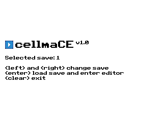
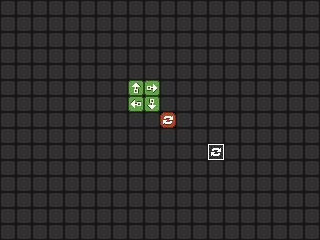
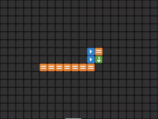
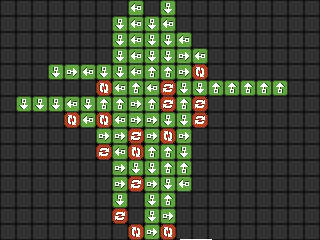

# cellmaCE

this is a [cell machine](https://samhogan.itch.io/cell-machine) mod/clone for the ti-84+ ce calculator.

   

## how to play

i assume you are somewhat familiar with the concept of cell machine already. if not, you can take a look at [CelLua](https://cellua.miraheze.org/wiki/Main_Page) too.

### controls

#### simulation control

- **y=** start/pause
- **window** reset the grid
- **zoom** step

#### navigation & editing

- **arrow keys** navigate through the grid
- **2nd** place selected cell
- **alpha** erase cell
- **numpad** change cell type
- **+** and **-** rotate cell

## development

- [x] accurate simulation
- [x] saving/loading
- [ ] animations
- [x] better ui
