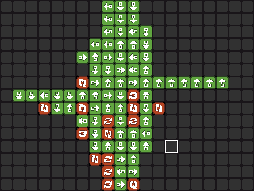

# cellmaCE

this is a [cell machine](https://samhogan.itch.io/cell-machine) mod/clone for the ti-84+ ce calculator.

## how to play

i assume you are somewhat familiar with the concept of cell machine already. if not, you can take a look at [CelLua](https://cellua.miraheze.org/wiki/Main_Page) too.

### controls

- **arrow keys** navigate through the grid
- **y=** start/pause the simulation
- **window** reset the simulation
- **zoom** step through the simulation
- **2nd** place selected cell
- **alpha** erase cell
- **mode** open cell selector
  - **left and right** change selected cell
  - **up and down** rotate cells

## development

- [x] accurate simulation
- [ ] saving/loading
- [ ] animations
- [ ] better ui
